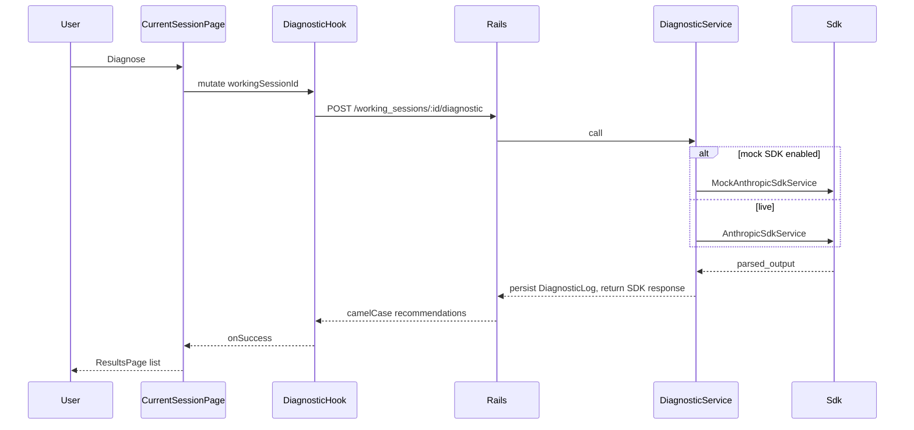

# Setup Recommendations Plan

Technical blueprint for [`docs/features/setup_recommendations.md`](../features/setup_recommendations.md). Implement in the three parts below. After each part, stop for commit. Do not start the next part until asked.

Source brief: the user is on Current Session with at least one handling characteristic, clicks Diagnose, and needs Le Mans Ultimate garage targets so they can change the car and get back on track.

## Current gap

- [`client/src/App.tsx`](../../client/src/App.tsx) `handleSubmitDiagnosis` only sets `currentView` to `'results'`.
- [`client/src/pages/ResultsPage.tsx`](../../client/src/pages/ResultsPage.tsx) always renders three prose strings from [`client/src/data/mockVehicleData.ts`](../../client/src/data/mockVehicleData.ts).
- `POST /api/v1/working_sessions/:working_session_id/diagnostic` already exists and always constructs [`AnthropicSdkService`](../../server/app/services/anthropic_sdk_service.rb). Specs stub `DiagnosticService`; there is no runtime mock.

## Product decisions

- Keep the button label **Diagnose**.
- Disable Diagnose when the current session has no handling deficits (client-side only).
- Results list shows **target garage settings**, not free-text sentences. SDK values are in-game targets, not deltas.
- While the diagnostic request is in flight, disable Diagnose and show `Diagnosing…`. No waving-flag spinner in this pass.
- Thought process stays on `DiagnosticLog` and is not returned or shown.
- Do not implement diagnostic response cache.

## Database schema

No migrations. No new tables, columns, or indexes.

`DiagnosticService` continues to persist `DiagnosticLog` after a successful mock or live SDK response.

## Internal API contract

Unchanged from the existing diagnostics endpoint.

- **Method / path:** `POST /api/v1/working_sessions/:working_session_id/diagnostic`
- **Request body:** none. Handling deficits come from the loaded working session.
- **Success `200`:**

```json
{
  "recommendations": {
    "rearArb": 5,
    "tcSlip": 8
  }
}
```

- **Empty SDK output:** `{ "recommendations": {} }`
- **Errors:**
  - `404` `{ "errors": ["Working session not found"] }`
  - `504` `{ "errors": ["Setup recommendation request timed out"] }`
- **Omitted:** `thoughtProcess` / thought process text.

Allowed recommendation keys (snake on the SDK, lowerCamel in JSON): `brakeBias`, `rearWing`, `frontRideHeight`, `rearRideHeight`, `frontArb`, `rearArb`, `tirePressures`, `tcCut`, `tcSlip`.

---

## Part 1 — Backend mock SDK

Intercept at the existing collaborator seam. [`DiagnosticService`](../../server/app/services/diagnostic_service.rb) already accepts `anthropic_sdk_service:`. Default that collaborator from config so development and test never construct `Anthropic::Client`.

### Config

`config.x.diagnostic.use_mock_sdk`

- [`server/config/environments/development.rb`](../../server/config/environments/development.rb) and [`server/config/environments/test.rb`](../../server/config/environments/test.rb): `true` unless `ENV["DIAGNOSTIC_LIVE_SDK"] == "true"`
- [`server/config/environments/production.rb`](../../server/config/environments/production.rb): always `false`

### Mock service

New [`server/app/services/mock_anthropic_sdk_service.rb`](../../server/app/services/mock_anthropic_sdk_service.rb):

- Same public method as [`AnthropicSdkService`](../../server/app/services/anthropic_sdk_service.rb): `generate_response(system_rules:, messages:, output_format:)`
- Returns a duck-typed message with `parsed_output` and `content` (include a short thinking block so `DiagnosticLog` persistence still records thought process)
- Shared constant for the mock payload, used by the service and the request spec:

```ruby
{
  "front_arb" => 5,
  "tire_pressures" => 145,
  "brake_bias" => 52.0
}
```

Values must be members of [`DiagnosticService::OUTPUT_SCHEMA`](../../server/app/services/diagnostic_service.rb) enums.

### Default collaborator

```ruby
anthropic_sdk_service: (
  Rails.application.config.x.diagnostic.use_mock_sdk ?
    MockAnthropicSdkService.new :
    AnthropicSdkService.new
)
```

XML assembly and `DiagnosticLog` persistence still run. Only the paid SDK call is skipped.

Keep existing examples in [`server/spec/requests/api/v1/diagnostics_spec.rb`](../../server/spec/requests/api/v1/diagnostics_spec.rb) that stub `DiagnosticService` for timeouts, 404, and empty `parsed_output`.

No controller contract change.

---

## Part 2 — Disable Diagnose with no handling deficits

Do this after the mock SDK and **before** the diagnostic POST. Diagnose still uses the current local view switch and mocked Results copy. Only enablement changes.

### UI

In [`client/src/pages/CurrentSessionPage.tsx`](../../client/src/pages/CurrentSessionPage.tsx):

- `disabled={handlingCharacteristics.length === 0}`
- Keep the Diagnose label (no `Diagnosing…` yet)
- Do not POST, do not add diagnostic loading/error UX

An empty list also covers the loading flash before deficits are seeded into App state.

No backend validation in this pass. The diagnostic endpoint may still accept a session with zero deficits.

---

## Part 3 — Frontend round trip

### 1. Frontend component hierarchy (props, state, hooks)

**[`client/src/App.tsx`](../../client/src/App.tsx)**

- New state: `recommendations: SetupRecommendations | null`
- `handleSubmitDiagnosis(recommendations)` stores the payload and sets `currentView` to `'results'`
- Clear recommendations in `handleWorkOnAnotherSession`
- Pass `recommendations` into `ResultsPage`

**[`client/src/pages/CurrentSessionPage.tsx`](../../client/src/pages/CurrentSessionPage.tsx)**

- Props: change `onSubmit: () => void` to `onSubmit: (recommendations: SetupRecommendations) => void`
- Local state: `diagnosticError: string | null`
- Hook: `useCreateDiagnostic()` (`isPending` as `isDiagnosing`)
- Diagnose: `disabled={isDiagnosing || workingSessionId == null || handlingCharacteristics.length === 0}`
- While pending: label `Diagnosing…`, `aria-busy`
- Stay on Current Session until success; render joined `errors[]` above the button

**[`client/src/pages/ResultsPage.tsx`](../../client/src/pages/ResultsPage.tsx)**

- New prop: `recommendations: SetupRecommendations`
- Map entries to labeled rows via the formatter
- Empty object: `No setup changes recommended.`
- Remove `MOCK_SUGGESTED_SETUP_CHANGES`; delete [`client/src/data/mockVehicleData.ts`](../../client/src/data/mockVehicleData.ts) if unused

**New files**

- [`client/src/types/diagnostic.ts`](../../client/src/types/diagnostic.ts): `SetupRecommendations`, `DiagnosticResponse`
- Formatter helper (pure function, not a component): labels + units for the nine garage keys
- [`client/src/hooks/useCreateDiagnostic.ts`](../../client/src/hooks/useCreateDiagnostic.ts)

No new visual components. Icons and flag spinner stay out of this pass.

**Formatter output (canonical key order)**

Order matches `DiagnosticService::OUTPUT_SCHEMA` properties: `brakeBias`, `rearWing`, `frontRideHeight`, `rearRideHeight`, `frontArb`, `rearArb`, `tirePressures`, `tcCut`, `tcSlip`.

| Key | Label | Display |
| --- | --- | --- |
| `brakeBias` | Brake bias | `{n.toFixed(1)}%` |
| `rearWing` | Rear wing | `{n}` |
| `frontRideHeight` | Front ride height | `{n} mm` |
| `rearRideHeight` | Rear ride height | `{n} mm` |
| `frontArb` | Front anti-roll bar | `{n}` |
| `rearArb` | Rear anti-roll bar | `{n}` |
| `tirePressures` | Tire pressures | `{n} kPa` |
| `tcCut` | TC cut | `{n}` |
| `tcSlip` | TC slip | `{n}` |

Mock payload therefore renders as:

1. `Brake bias: 52.0%`
2. `Front anti-roll bar: 5`
3. `Tire pressures: 145 kPa`

### 2. Data flow and Rails API integration

Mirror [`useCreateWorkingSession`](../../client/src/hooks/useCreateWorkingSession.ts): Axios + TanStack Query `useMutation`.

```ts
apiClient.post<DiagnosticResponse>(
  `/working_sessions/${workingSessionId}/diagnostic`,
)
```

- Empty POST body
- Success: pass `data.recommendations` to `onSubmit`
- Error: `isAxiosError<{ errors?: string[] }>` and join `errors`, same pattern as deficit save/delete

Playwright intercepts at the browser. New [`client/tests/helpers/diagnosticApi.ts`](../../client/tests/helpers/diagnosticApi.ts) fulfills the same camelCase contract as the Rails mock so tests never hit Anthropic.



---

## Spec blueprint

Write the tests for a part first. Confirm they fail, then implement that part.

### RSpec (Part 1)

1. Request (no `DiagnosticService` stub): `POST` against a FactoryBot working session returns camelCase mock recommendations `{ "frontArb": 5, "tirePressures": 145, "brakeBias": 52.0 }` (key order may follow the serializer; assert on equality of the object) and omits thought process from the body.
2. That same request persists a `DiagnosticLog`.
3. `MockAnthropicSdkService#generate_response` `parsed_output` keys and values are members of `DiagnosticService::OUTPUT_SCHEMA` properties / enums.

### Playwright (Part 2)

Use existing helpers [`addHandlingCharacteristic`](../../client/tests/helpers/handlingCharacteristics.ts) and [`deleteHandlingCharacteristic`](../../client/tests/helpers/handlingCharacteristics.ts). No diagnostic API helper yet.

1. Current Session with an empty deficit list: Diagnose is visible and **disabled**.
2. After adding one handling characteristic: Diagnose becomes **enabled**.
3. After deleting the last handling characteristic: Diagnose is **disabled** again.
4. Existing Diagnose-click paths in [`client/tests/suggestions.spec.ts`](../../client/tests/suggestions.spec.ts) and [`client/tests/navigation.spec.ts`](../../client/tests/navigation.spec.ts) add at least one characteristic before clicking Diagnose.

### Playwright (Part 3)

Every Diagnose click is backed by a diagnostic route mock. Those clicks already require a deficit from Part 2.

1. Diagnose is visible on Current Session (disabled until a deficit exists).
2. Diagnose POST goes to `/api/v1/working_sessions/:id/diagnostic`.
3. Diagnose is disabled and shows `Diagnosing…` while the request is in flight.
4. On success, Results lists the formatted mock rows (`Brake bias: 52.0%`, `Front anti-roll bar: 5`, `Tire pressures: 145 kPa`), not the old prose strings.
5. Empty `recommendations: {}` shows `No setup changes recommended.`
6. API `errors[]` (504) stay on Current Session and do not open Results.
7. Back from Results keeps car, track, and handling characteristics.
8. Work on Another Session returns to Start and clears session state.
9. Existing navigation graph still reaches Results via Diagnose.

---

## Step-by-step implementation phases

1. **Part 1:** `MockAnthropicSdkService`, env-gated default collaborator, RSpec. Stop for commit.
2. **Part 2:** Disable Diagnose with zero handling deficits; Playwright coverage and Diagnose-click test updates. Verify in the browser at `http://localhost:5173` (empty → disabled; add → enabled; delete last → disabled). Stop for commit.
3. **Part 3:** Diagnostic Playwright helper and failing specs, then types/hook/pages. Verify in the browser (Diagnose → `Diagnosing…` → Results; error path; Back). Stop for commit.
4. After Part 3: ask to add deferred spinner/icons to [`docs/planning_roadmap.md`](../planning_roadmap.md) as a separate commit.

## Out of scope

- Waving green flag spinner and setup-category icons
- Showing thought process in the UI
- `DIAGNOSTIC_LIVE_SDK` behavior in production beyond “never mock”
- Diagnostic response cache
- Renaming Diagnose to “Run Diagnostic”
- Server-side rejection of diagnostic POST when the session has no handling deficits
